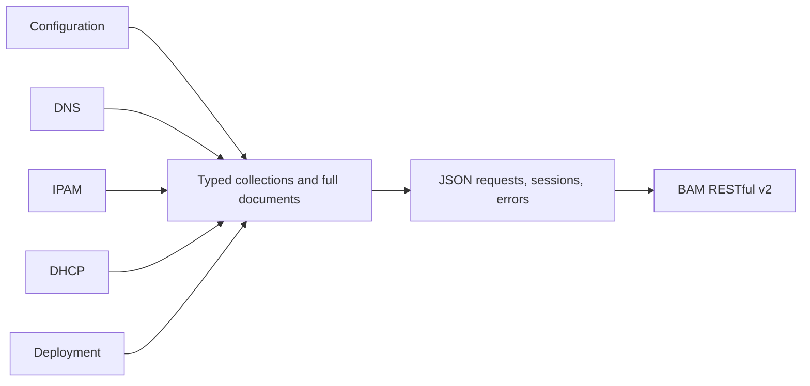

# RESTful v2 domain modules

Status: historical v0.1.0 decision. Transport and lossless-document decisions
remain accepted. Domain capabilities and deployment polling below are superseded
by [ADR 0002](0002-typed-domain-capabilities.md).

The former client exposed 256 generated SOAP operations in one file, global
cookie state, and legacy property strings. The selected direction is a clean
RESTful v2 implementation without preserving the old Go or wire contracts.

Each business module owns its resource names, scopes and create specifications.
The shared collection module owns CRUD, pagination and document preservation.
The shared client owns HTTP and authentication. The injected `http.Client` is
the transport seam; tests exercise public operations against an HTTP server.
There is no generated operation interface, global session, catch-all business
client, or invented interface for a single implementation.

Go generics share collection behavior while keeping read results typed.
`iter.Seq2` provides cancellable lazy traversal without a producer goroutine.
`netip` represents addresses and prefixes, and `json.RawMessage` preserves fields
outside the typed read models. Go 1.23 is the minimum version; no third-party
runtime dependency is required.

Protocol decisions:

- The baseline is BAM 9.6, whose v2 authentication uses the returned Basic
  credentials. Tokens from v1 and v2 are not interchangeable. Session changes
  are serialized with cancellable waiting; ordinary requests may run concurrently.
  [Authentication changes](https://docs.bluecatnetworks.com/r/Address-Manager-RESTful-v2-API-Guide/What-s-New-in-v9.6.0/9.6.0)
- HTTP errors retain their actual status even when their body cannot be read.
  Routine error strings exclude server messages, which could echo credentials.
  Responses are bounded and redirects are rejected. Writes have no automatic
  retry. [Error representation](https://docs.bluecatnetworks.com/r/Address-Manager-RESTful-v2-API-Guide/Errors/9.6.0)
- Collection count describes one page. Traversal follows HAL links, preserves
  the original selection, rejects cycles and scope changes, and reports a page
  budget failure instead of silently truncating results.
  [Pagination](https://docs.bluecatnetworks.com/r/Address-Manager-RESTful-v2-API-Guide/Pagination/9.6.0)
- Typed read models are projections. Full replacement requires a `Document`
  with matching identity so unknown fields survive a GET/edit/PUT cycle. This
  does not make concurrent edits atomic; callers needing conditional requests
  can use `Client.Do` with headers supported by their BAM version.
  [Updating resources](https://docs.bluecatnetworks.com/r/Address-Manager-RESTful-v2-API-Guide/Updating-resources/9.6.0)
- HTTP 202 produces `AcceptedError` with the pending document. It never becomes
  a successful typed create. Deployment task states remain explicit server data;
  there is no guessed completion predicate or automatic polling.
  [Workflow changes](https://docs.bluecatnetworks.com/r/Address-Manager-RESTful-v2-API-Guide/What-s-New-in-v9.6.0/9.6.0)

The common collection interface intentionally does not encode the complete
endpoint-by-verb capability matrix. Global item paths use global IDs; child
paths scope listing and creation. Relationship mutations, such as MAC pool
membership, cannot be represented as ordinary resource deletion.

The public guide is not the complete resource schema. Verified typed create
specifications cover configurations, views, zones, host records, CIDR blocks and
networks, and exact addresses. DHCP, deployments and additional fields use full
JSON documents. No legacy parity claim or inferred next-address request is made.
Unknown request fields may be ignored by the server, so additional typed
specifications require the target appliance's OpenAPI rather than guessed
field names. [Creating resources](https://docs.bluecatnetworks.com/r/Address-Manager-RESTful-v2-API-Guide/Creating-resources/9.6.0),
[OpenAPI location](https://docs.bluecatnetworks.com/r/Address-Manager-RESTful-v2-API-Guide/Using-an-API-client/9.6.0).

The local contract suite covers request paths and bodies, credential isolation,
cancellation, HTTP and malformed-response failures, lossless replacement,
pagination, and pending workflow results. Real-appliance acceptance remains
separate from these tests.
