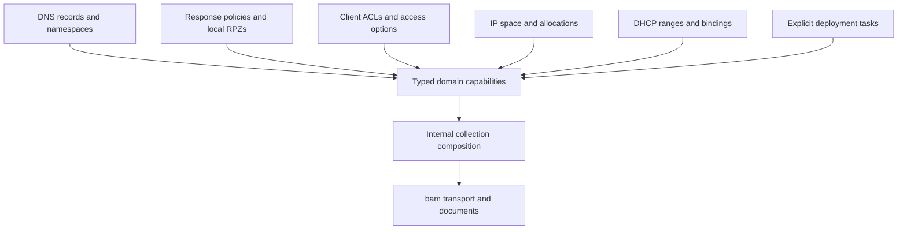

# Typed domain capabilities

Status: accepted and implemented in v0.2.0.
Supersedes the raw-domain and no-polling boundaries of ADR 0001.

The initial v0.1.0 transport was reusable, but exposing generic collections for
every domain left callers to construct DHCP/deployment JSON, distinguish IP
states and discover unsupported operations themselves. DNS blacklist workflows
also require different models for domain policies and client access control.

## Decision

Keep `bam` as the protocol boundary and compose small internal generic handles
for lists, reads, existing-item mutations and scoped creation. Public domain
handles expose only the relevant operations. Task/server discovery is read-only;
global resource selectors do not create children; relationship handles expose
Link/Unlink rather than resource deletion.

Create specifications encode verified fields and resource types. Changes use
`bam.Field[T]` so absent, explicit zero and null remain distinct. Each domain
checks nullable fields and state transitions; shared code performs full
GET/edit/PUT with raw JSON preservation. DNS host updates additionally retain
the complete paginated address association set. No write is retried implicitly.

Use distinct record variants and allocation operations instead of one large
optional-field struct. IP values use `netip`; MAC and ACL elements have dedicated
value types. `bam.Value` is the lossless extension point for schema-defined
deployment option values, with typed constructors for common options. String
discriminators remain at the wire boundary rather than in callers' workflows.

Resolve IP/MAC queries within a configuration. Exact queries must distinguish
absence and ambiguity; a lazy iterator remains available for multiple results.
The next-address operation delegates selection and allocation to one BAM POST.
Listing available addresses never claims them.

Configure resources, roles and options separately from deployment. Submission
returns a task; bounded waiting interprets verified states and preserves warnings.
Context cancellation stops observation without cancelling server work. Existing
appliance dynamic-update settings are not changed as a side effect.

## Evidence and consequences

The [capability matrix](../rest-v2-coverage.md) pins the preserved vendor 9.5 schema
and the official 9.6 deltas. Unknown fields survive reads/updates; unverified
request schemas remain named gaps. Generic `Client.Do`/`Collection` access does
not count as a completed domain capability.

The public API intentionally breaks v0.1.0 domain collection types. Consumers
replace document-based domain writes with a specification or changes type, and
select explicit relation/deployment operations. Advanced device-specific calls
can still choose the low-level transport deliberately.

HTTP contract tests exercise public operations rather than mock domain interfaces.
Shared implementations reduce repeated transport behavior while files remain
organized by resource and responsibility. There are no new runtime dependencies.
Real 9.6 appliance acceptance remains separate from local tests.
